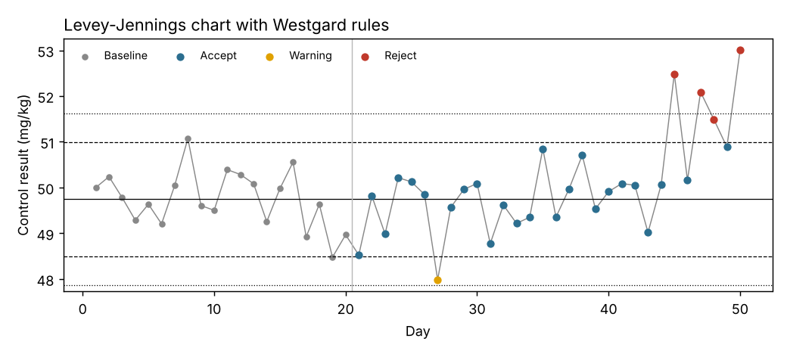

# labqc: laboratory quality calculations in Python

[](https://github.com/mantas123456/lab-quality-toolkit/actions/workflows/ci.yml)

The calculations an ISO/IEC 17025 laboratory does every week, usually in spreadsheets,
written as small, tested Python functions:

| Module | What it covers | Reference |
|---|---|---|
| `uncertainty` | GUM uncertainty budgets: Type A and B components, sensitivity coefficients (analytic or numerical), Welch–Satterthwaite degrees of freedom, coverage factor | JCGM 100:2008 (GUM) |
| `validation` | Calibration linearity with confidence intervals, LOD/LOQ, precision (RSD), spike recovery | ICH Q2, Eurachem guide |
| `proficiency` | z, zeta and E<sub>n</sub> scores with interpretation; robust consensus mean (Algorithm A) | ISO 13528, ISO/IEC 17043 |
| `control_charts` | Shewhart limits; Westgard rules 1<sub>2s</sub>, 1<sub>3s</sub>, 2<sub>2s</sub>, R<sub>4s</sub>, 4<sub>1s</sub>, 10<sub>x</sub> | Westgard multirule QC |
| `emissions` | ppm ↔ mg/m³ at standard conditions, correction to reference O₂, wet ↔ dry | Stack-emission practice, e.g. EN 303-5 at 10 % O₂ |

Every function is tested against hand-calculated values (28 tests), and the examples below
run in CI.

## Example 1: uncertainty of a moisture determination

Oven-dry moisture of a wood-pellet sample, `M = (m2 − m3) / (m2 − m1) × 100`, with balance
calibration and resolution for each weighing plus repeatability from five test portions.
Sensitivity coefficients are found numerically from the model function
([`examples/moisture_uncertainty.py`](examples/moisture_uncertainty.py)).

```text
                      component     u_i    c_i  contribution  dof  share_of_variance
Repeatability (5 test portions)  0.0191      1        0.0191    4              0.996
                    Weighing m3 0.00104 -0.798       0.00083  inf            0.00188
                    Weighing m2 0.00104  0.742      0.000772  inf            0.00162
                    Weighing m1 0.00104 0.0556      5.79e-05  inf           9.12e-06

u_c = 0.01916, v_eff = 4.0, k = 2.77, U (95%) = 0.05306
Report: M = 6.97 % ± 0.05 % (k = 2.77, 95 %)
```

Over 99 % of the variance comes from sample repeatability. A better balance would change
nothing; more test portions would. With only four degrees of freedom the coverage factor is
2.77, not 2, which a fixed "k = 2" spreadsheet gets wrong.

## Example 2: Westgard rules on daily QC

Twenty baseline days set the limits. A +1.4 mg/kg shift is introduced from day 45
([`examples/westgard_iqc.py`](examples/westgard_iqc.py)).



```text
    value      z   status             rules
27  47.99 -2.817  warning              1_2s
45  52.49  4.385   reject        1_2s, 1_3s
47  52.09  3.745   reject        1_2s, 1_3s
48  51.50  2.798   reject        1_2s, 2_2s
50  53.00  5.206   reject  1_2s, 1_3s, 4_1s
```

Day 27 is a lone 1<sub>2s</sub> warning that needs no action. The shift is caught on its
first day, and the 2<sub>2s</sub> and 4<sub>1s</sub> rules confirm the error is systematic
(calibration), not random.

## Example 3: boiler test emissions at reference oxygen

```text
Measured O2 12.8 %, correction factor 1.346
CO      310.0 ppm  ->    521.3 mg/m3 at 10 % O2   (104% of example limit)
NO2     118.0 ppm  ->    325.9 mg/m3 at 10 % O2
C3H8      6.5 ppm  ->     17.2 mg/m3 at 10 % O2
```

At high excess air, a raw reading that looks comfortably low can exceed a limit once it is
corrected to 10 % O₂ ([`examples/boiler_emissions.py`](examples/boiler_emissions.py)).

## Use it

```bash
pip install git+https://github.com/mantas123456/lab-quality-toolkit
```

```python
from labqc.uncertainty import Component, combine, type_a
from labqc.proficiency import z_score, classify

budget = [
    type_a([10.02, 10.05, 9.98, 10.01, 10.03]),
    Component("Reference standard", 0.010, "normal", k=2),
    Component("Temperature effect", 0.004, "rectangular"),
]
print(combine(budget))  # u_c, v_eff, k, U

z = z_score(10.75, assigned=10.0, sigma_pt=0.3)
print(round(z, 2), classify(z))  # 2.5 questionable
```

## Develop

```bash
pip install -e ".[dev]"
pytest
ruff check .
```

## Scope and limits

- Inputs are treated as uncorrelated. Correlated inputs (for example one balance used for
  several weighings) need covariance terms, which are not implemented yet. Ignoring a
  positive correlation between weighings that are subtracted overstates the uncertainty.
- Sensitivity coefficients are first-order. Strongly non-linear models need a Monte Carlo
  approach (GUM Supplement 1), which is planned.
- This is a calculation aid, not validated software for regulated use. Check results
  against your own procedures.

---
Mantas Valantinavičius · measurement scientist, 14 years in ISO/IEC 17025 testing ·
[github.com/mantas123456](https://github.com/mantas123456)
